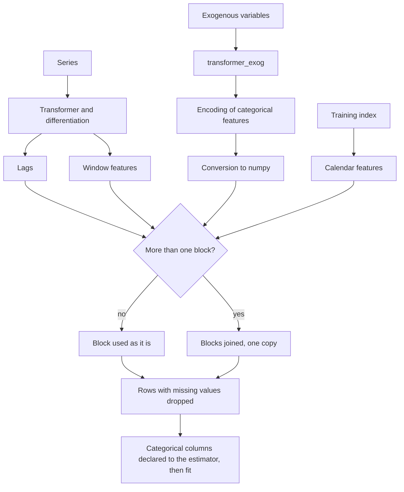
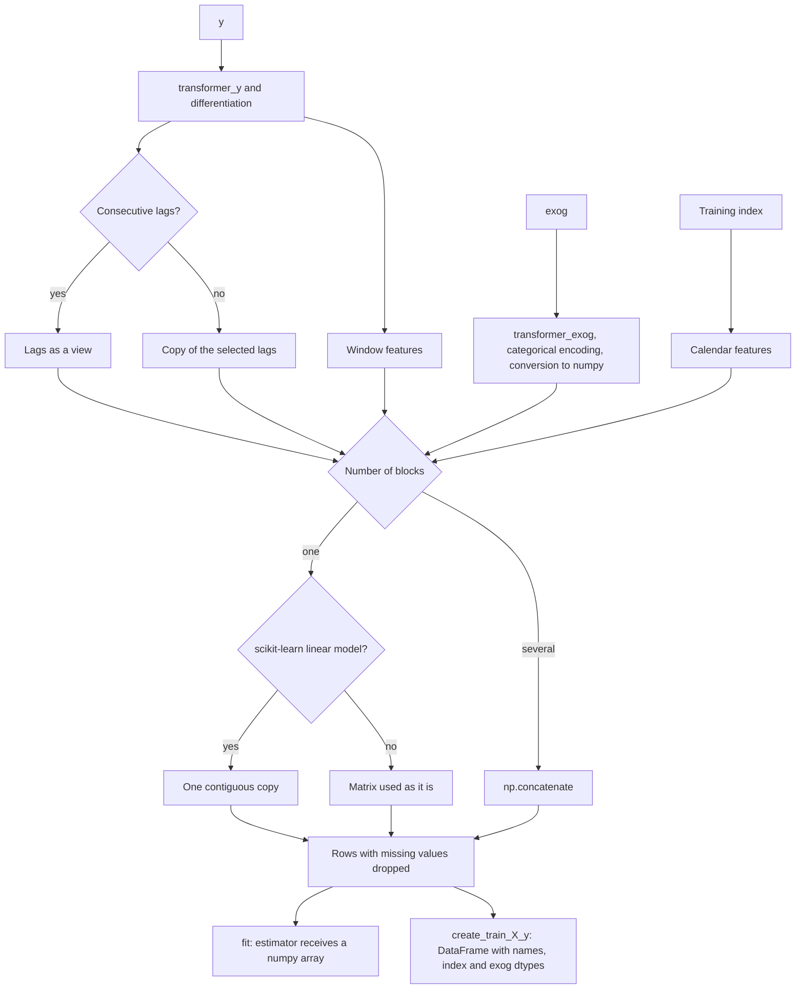
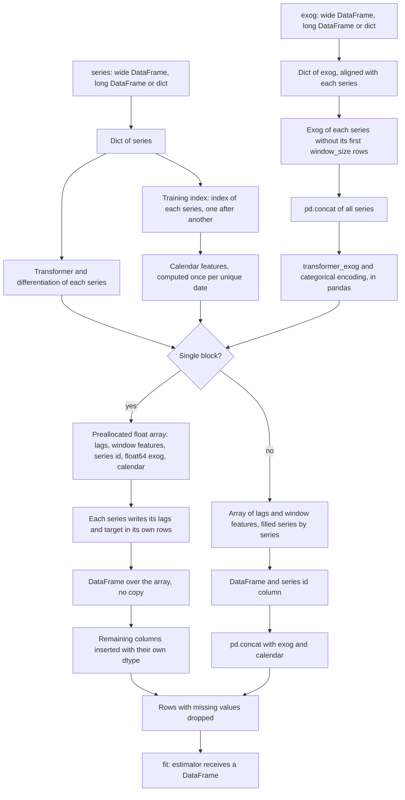
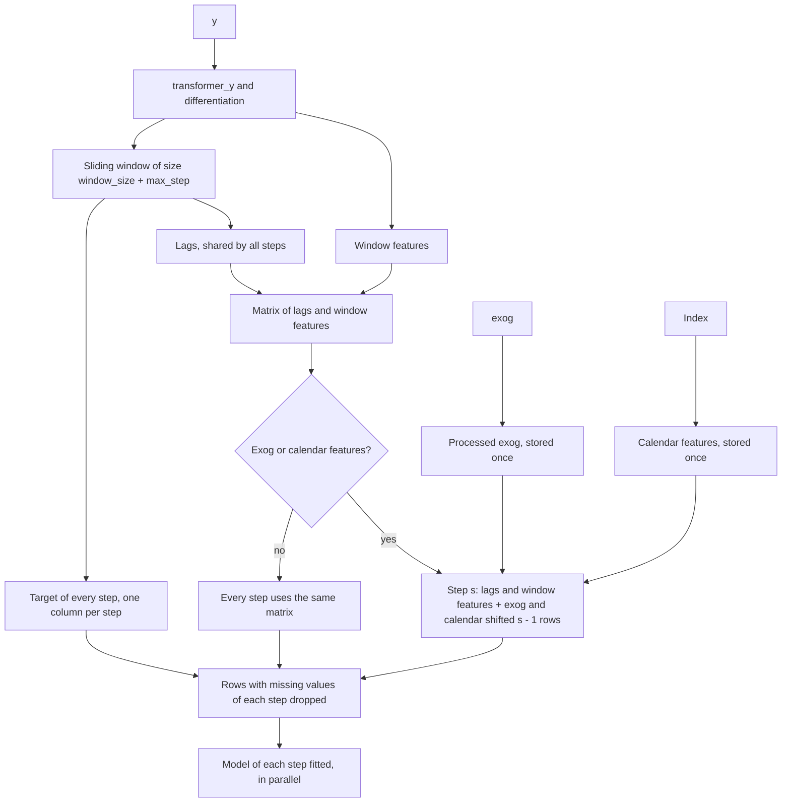
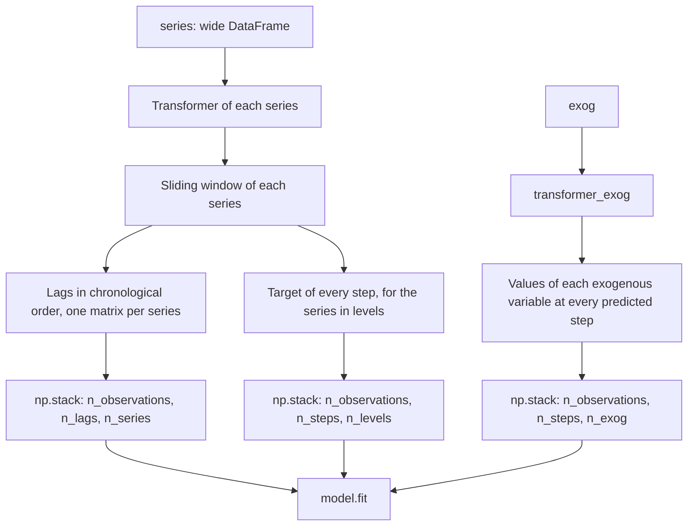

# How forecasters create the training matrices

Forecasters that use a machine learning estimator turn the time series, and the exogenous variables if there are any, into a matrix of predictors (`X_train`) and a target (`y_train`). This page explains how each forecaster builds these matrices: which path the data follows depending on the predictors used (lags, window features, numeric or categorical exogenous variables, calendar features), and whether the estimator receives a numpy array or a pandas DataFrame.

Two ideas guide the design:

+ **Avoid copies.** A training matrix can be much larger than the series it comes from: with 365 lags, every value of the series is repeated 365 times. Whenever possible, skforecast builds the matrix as a view of the series values, or writes it once into a preallocated array, instead of creating intermediate copies.

+ **Work with numpy, keep pandas where it matters.** Most of the work is done with numpy arrays, which are faster to slice and join. pandas is used where it adds something: to apply transformers, to encode categorical features, to keep the dtypes of the exogenous variables, and in the matrices returned by `create_train_X_y`.

The method `create_train_X_y` returns the training matrices as pandas objects, with column names and index, so that they can be inspected (see [Training and prediction matrices](../user_guides/training-and-prediction-matrices.ipynb)). Inside `fit`, most forecasters skip the conversion to pandas and give the numpy arrays directly to the estimator.

!!! note

    This page describes how skforecast 0.28 works internally. These details can change between versions without notice; the matrices returned by `create_train_X_y` are the stable way to see what the estimator is trained with.

## Summary

| Forecaster | How `X_train` is built | What the estimator receives | Exogenous variables | Rows with missing values |
|---|---|---|---|---|
| `ForecasterRecursive` | One numpy array: lags, window features, exogenous and calendar features side by side | numpy array | Converted to numpy before joining | Dropped once, on the whole matrix |
| `ForecasterRecursiveClassifier` | Same as `ForecasterRecursive`, with the target encoded as class codes | numpy array | Same as `ForecasterRecursive` | Same as `ForecasterRecursive` |
| `ForecasterRecursiveMultiSeries` | The rows of each series one after another, written into a preallocated array when possible | pandas DataFrame | Stacked series by series, each column with its own dtype | Dropped once, on the whole matrix |
| `ForecasterDirect` | One matrix of lags and window features shared by all steps, plus the exogenous and calendar features stored once | One numpy array per step | Stored once and shifted for each step | Dropped for each step |
| `ForecasterDirectMultiVariate` | Same as `ForecasterDirect`, with the lags and window features of every series | One numpy array per step | Same as `ForecasterDirect` | Dropped for each step |
| `ForecasterRnn` | Three-dimensional numpy arrays | Three-dimensional numpy arrays | Three-dimensional array with their values at the predicted steps | Not allowed |

`ForecasterStats`, `ForecasterEquivalentDate` and `ForecasterFoundation` do not create training matrices, see [Forecasters without training matrices](#forecasters-without-training-matrices).

## Common building blocks

`ForecasterRecursive`, `ForecasterRecursiveClassifier`, `ForecasterRecursiveMultiSeries`, `ForecasterDirect` and `ForecasterDirectMultiVariate` build their matrices from the same pieces. They differ in how they combine them, as the following sections explain.

### Lags

The training rows start after the first `window_size` observations of the series, since those have no complete history: a series of length `n` gives `n - window_size` rows. `window_size` is the largest of the maximum lag and the window size of the window features, plus the order of differentiation if `differentiation` is used.

For example, with `lags=3`, the series `10, 11, 12, 13, 14, 15` (dates `t1` to `t6`) gives three rows:

| Date | `lag_1` | `lag_2` | `lag_3` | `y` |
|---|---|---|---|---|
| t4 | 12 | 11 | 10 | 13 |
| t5 | 13 | 12 | 11 | 14 |
| t6 | 14 | 13 | 12 | 15 |

Each row repeats values of its neighbours. Instead of copying them, skforecast uses numpy `sliding_window_view`, which returns all the windows of the series as a two-dimensional array that points to the memory of the series (after the transformer and the differentiation, if any). The lags are then selected from these windows:

+ **Consecutive lags** (`lags=24`, or `lags=[1, 2, 3]`): the lags are a slice of the windows, reversed so that `lag_1` is the first column. A slice of a view is still a view, so the lag matrix takes no extra memory.

+ **Non consecutive lags** (`lags=[1, 7, 14]`): the columns are picked with a list of positions, which numpy always resolves with a copy. Only the selected columns are copied.

The target (`y_train`) is also a view: the series values after the first `window_size` observations.

### Window features

Window features (for example, `RollingFeatures`) are computed with their method `transform_batch`, which receives the series as a pandas Series (after the transformer and the differentiation) and returns a DataFrame. The forecaster keeps its last `n - window_size` rows, checks that their index matches the training index, and converts them to numpy. See [Window and custom features](../user_guides/window-features-and-custom-features.ipynb).

### Exogenous variables

Exogenous variables go through four steps:

1. **Transformation.** `transformer_exog` is applied, if any. It works on the DataFrame, so it can add or remove columns (for example, a `OneHotEncoder` inside a `ColumnTransformer`).

2. **Encoding of categorical features.** With `categorical_features='auto'` (the default), every column that is not numeric or boolean after `transformer_exog` is categorical; a list of names can be given instead. These columns are encoded with an `OrdinalEncoder` fitted in `fit`: each category becomes a code (`0`, `1`, `2`...) stored as float, and missing values and categories not seen in training become `NaN`. With `categorical_features=None`, nothing is encoded: a warning is issued for columns that are not numeric, and an error for `category` columns whose categories are not integers. See [Categorical features](../user_guides/categorical-features.ipynb).

3. **Conversion to numpy.** `DataFrame.to_numpy()` returns an array of dtype `object` when numpy cannot combine the dtypes of the columns. An `object` array is slower, uses more memory and is rejected by some estimators, so the conversion chooses the result from the dtypes alone:
    + Boolean columns next to numeric ones, or any nullable (`Int64`, `Float64`, `boolean`), pyarrow or `category` column with integer categories, give a `float64` array in which missing values are `NaN`.
    + Columns that numpy combines on its own (all float, all integer, integer and float, all boolean) are converted directly.
    + Only text, dates and other types that are not numbers give an `object` array.

4. **Alignment.** The first `window_size` rows are removed, so that each row of the exogenous variables matches a training row. `exog` can also start already after them.

The DataFrame returned by `create_train_X_y` gives each exogenous column back the dtype it had before the conversion to numpy, so an integer or boolean column does not appear as float.

### Calendar features

Calendar features (`calendar_features`) are created from the training index, which must be a `DatetimeIndex`, and converted to numpy. They never have missing values. See [Calendar features](../user_guides/calendar-features.ipynb).

### Joining the blocks

If the matrix has a single block (for example, only lags), it is used as it is, without a copy. This view is not stored contiguously in memory, and some linear models of scikit-learn copy such an array again in every product with `X`. For those models only, the forecaster makes one contiguous copy before training. Other estimators, such as tree based models and gradient boosting, convert the matrix to their own format anyway, and the extra copy would only use more memory.

If there are several blocks, they are joined with `np.concatenate`, which makes a single copy.

### Missing values

Rows whose target is missing are always removed, since there is nothing to learn from them. Rows with missing values in the predictors (missing values of the series that end up in the lags, or missing values in `exog`) are removed only if `dropna_from_series=True`. Otherwise they are kept, which suits estimators that handle missing values, such as LightGBM or `HistGradientBoostingRegressor`. A single warning reports how many rows of each kind there are. When there are no missing values, the check costs a single scan of the matrix. See [Handling missing values](../user_guides/handling-missing-values.ipynb).

### Native categorical support

In `fit`, once the matrix is built, the forecaster tells the estimator which columns are categorical, using their positions in the matrix:

+ **LightGBM**: `categorical_feature`, passed to `fit`.
+ **CatBoost**: `cat_features`, passed to `fit`. CatBoost requires integer categories, so these columns are converted to integers and their missing values to `-1`, which CatBoost treats as one more category.
+ **XGBoost**: `feature_types` and `enable_categorical=True`, set with `set_params`.
+ **`HistGradientBoostingRegressor` and `HistGradientBoostingClassifier`**: `categorical_features`, set with `set_params`.

Other estimators receive the ordinal codes as numbers. If the estimator is a scikit-learn `Pipeline`, nothing is configured, since its first steps can reorder or remove columns.

## ForecasterRecursive

`ForecasterRecursive` follows the common path from start to end with numpy arrays. A single model is trained with all the rows, so the matrix is built once.

+ The estimator receives a numpy array. The column names are kept in `X_train_features_names_out_` and used to find the positions of the categorical columns.
+ In a hyperparameter search with one-step-ahead predictions, the training and test matrices are built once for each value of the lags grid, and reused by all the hyperparameter combinations tested with those lags.

## ForecasterRecursiveClassifier

`ForecasterRecursiveClassifier` builds the matrix like `ForecasterRecursive`, with these differences:

+ The target contains class labels (text, integers, or floats without decimals). They are encoded as integer codes, from `0` to `n_classes - 1`, before the lags are created, so both the lags and the target are class codes. Missing values are kept as `NaN`.
+ There is no `transformer_y`, differentiation or calendar features.
+ `features_encoding` decides how the estimator treats the features created from the target. With `'auto'` (the default), the lags and the window features whose name contains `mode` (they return class codes) are declared categorical if the estimator supports native categorical features, together with the categorical exogenous variables. `'categorical'` does the same, and raises an error if the estimator does not support them. With `'ordinal'`, these features are numbers.

See [Autoregressive classification forecasting](../user_guides/autoregressive-classification-forecasting.ipynb).

## ForecasterRecursiveMultiSeries

`ForecasterRecursiveMultiSeries` trains a single model with the rows of all the series, one series after another. It is the only forecaster that gives a pandas DataFrame to the estimator: each exogenous variable keeps its own dtype and, with `encoding='ordinal_category'`, the series identifier is a `category` column, which a numpy array cannot hold without turning everything into `object`. To keep this cost low, the DataFrame is built over a single preallocated block of memory whenever possible.

+ **Inputs.** `series` can be a wide DataFrame (one column per series), a long DataFrame with a MultiIndex (series id, date) or a dict of Series. `exog` can be a wide DataFrame (the same values for every series), a long DataFrame or a dict (one DataFrame per series, which can contain different variables). Both are converted to dicts, and the exogenous variables of each series are aligned with its index, so the series can have different lengths. See [Series with different length and different exogenous variables](../user_guides/multi-series-with-different-length-and-different_exog.ipynb).

+ **Series.** Each series has its own transformer and differentiator (with `encoding=None`, a single transformer is fitted on all the series together). Its lags, window features and target are created with the same numpy functions as in `ForecasterRecursive`.

+ **Exogenous variables.** They are stacked series by series with `pd.concat` and processed as a DataFrame, so each column keeps its dtype. A series without some exogenous variable gets missing values in that column.

+ **Calendar features.** The series usually share their dates, so the calendar features are computed once per unique date and then copied to every row with that date.

+ **Series identifier.** Depending on `encoding`, the matrix includes the column `_level_skforecast` with the code of the series (`'ordinal'`, the default), the same code as a `category` column (`'ordinal_category'`), one column of zeros and ones per series (`'onehot'`), or nothing (`None`: the column is created to identify the rows of each series and removed before training).

The matrix is assembled in one of two ways:

+ **Single block.** The forecaster preallocates one float array, stored column by column (the layout pandas uses internally), with room for the lags, the window features, the series identifier (with `'ordinal'`, `'onehot'` or `None`), the `float64` exogenous variables and the calendar features. Each series writes its rows directly into it, and the DataFrame is created over the array without a copy. The columns of other dtypes (exogenous variables that are not `float64`, and the identifier with `'ordinal_category'`) are then inserted one by one, each with its own dtype. This avoids the full copy that `pd.concat`, or later the estimator, would make to merge blocks of different dtypes.

+ **Concatenation.** The single block is not used when more columns would have to be inserted than the block has, when 100 or more columns would have to be inserted (pandas warns about fragmented DataFrames), or when the matrix has only lags and window features with `encoding=None` (the identifier column is removed before training, and that removal already makes a copy). In these cases, the lags and window features are written into their own array, and the identifier, the exogenous variables and the calendar features are joined with `pd.concat`.

In `fit`, an exogenous column of dtype `category` that is not managed by `categorical_features` is replaced by its values, the same values the estimator receives when predicting. `create_train_X_y` returns the DataFrame the estimator receives, except for the integer conversion of the categorical columns that is only applied for CatBoost.

See [Independent multi-series forecasting](../user_guides/independent-multi-time-series-forecasting.ipynb).

## ForecasterDirect

`ForecasterDirect` trains one model per step. All the models share the same lags and window features, but the target of step `s` is the value `s` positions ahead, and the exogenous and calendar features are those of the predicted date. With `lags=3` and `steps=2`, the series of the previous example gives:

| `lag_1` | `lag_2` | `lag_3` | `y_step_1` | `y_step_2` |
|---|---|---|---|---|
| 12 | 11 | 10 | 13 | 14 |
| 13 | 12 | 11 | 14 | 15 |

The model of step 1 is trained with the lags and `y_step_1`; the model of step 2, with the same lags and `y_step_2`. Instead of building one full matrix per step, the forecaster builds the shared parts once and assembles the matrix of each step when its model is trained.

+ **Lags and target together.** One `sliding_window_view` with windows of size `window_size + max_step` contains, in each row, the history (the lags) and the next `max_step` values (the target of every step). The target is a view, and so are the lags when they are consecutive.

+ **Exogenous and calendar features stored once.** With `steps=24` and 10 exogenous variables, the full direct matrix has 240 exogenous columns, of which each model uses only 10. The forecaster stores the processed exogenous variables once, with `max_step - 1` extra rows at the end, and the matrix of step `s` takes the rows shifted `s - 1` positions. Each step matrix is joined with `np.concatenate` just before its model is trained.

+ **Without exogenous or calendar features.** All the steps share the same matrix of lags and window features, without copies. The contiguous copy for scikit-learn linear models, if needed, is made once for all the steps.

+ **Missing values.** Each step has its own target, so the rows are dropped step by step. A single warning, computed without building the step matrices, reports the rows with missing values of each step.

+ **Parallel training.** The models of the steps are trained in parallel, as set by `n_jobs`.

`create_train_X_y` returns the full matrix: the lags and window features, followed by the exogenous and calendar features of every step with the suffixes `_step_1`, `_step_2`, etc. `filter_train_X_y_for_step` selects from it the columns and the target of one step. See [Direct multi-step forecasting](../user_guides/direct-multi-step-forecasting.ipynb).

## ForecasterDirectMultiVariate

`ForecasterDirectMultiVariate` predicts one series (`level`) using the lags and window features of several series. It follows the path of `ForecasterDirect`, repeated for each column of `series` (a wide DataFrame):

+ `lags` can be a dict with different lags per series, with `None` for the series that should not have lags. Whether the lags are consecutive is checked for each series.
+ Each series has its own transformer and differentiator.
+ For each series, the forecaster creates only what is needed: the lags (other series), the target (the `level` without lags), or both (the `level` with lags). Series without lags or window features are not processed.
+ The columns of each series start with its name (`sales_lag_1`, `sales_roll_mean_7`), and the blocks of all the series are joined with `np.concatenate`.
+ Exogenous and calendar features are stored once and shifted for each step, as in `ForecasterDirect`.

See [Dependent multi-series forecasting](../user_guides/dependent-multi-series-multivariate-forecasting.ipynb).

## ForecasterRnn

Keras models with recurrent layers expect three-dimensional arrays, so `ForecasterRnn` creates them with numpy and joins the series with `np.stack`:

| Array | Shape |
|---|---|
| `X_train` | `(n_observations, n_lags, n_series)` |
| `y_train` | `(n_observations, n_steps, n_levels)` |
| `exog_train` | `(n_observations, n_steps, n_exog)` |

+ Unlike in the other forecasters, the lags are kept in chronological order (oldest first), the order in which a recurrent layer reads a sequence.
+ The exogenous variables of each sample are their values at the predicted steps, not at the lags.
+ The windows of a series that is also a `level` are computed once and used for both its lags and its target.
+ Neither the series nor the exogenous variables can have missing values.

See [Deep learning forecasting with RNN and LSTM](../user_guides/forecasting-with-deep-learning-rnn-lstm.ipynb).

## Forecasters without training matrices

+ **`ForecasterStats`** wraps statistical models, such as ARIMA, SARIMAX, ETS or ARAR. After `transformer_y` and `transformer_exog`, the series and the exogenous variables are passed directly to the `fit` method of each model, which handles the time dependence itself.
+ **`ForecasterEquivalentDate`** predicts with the values of equivalent dates in the past (for example, the same hour of the previous week). It only stores the series.
+ **`ForecasterFoundation`** uses pretrained foundation models, which predict without training (zero-shot). `fit` only stores the last `context_length` observations of each series, and of their exogenous variables, as context. See [Foundation forecasting models](../user_guides/foundation-forecasting-models.ipynb).
